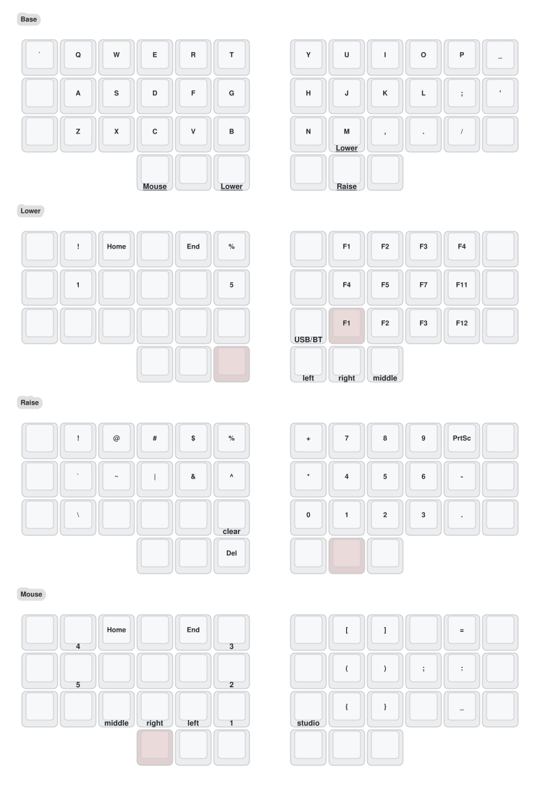

# Crosses 36 — vergilcw's ZMK config

 

Personal [ZMK](https://zmk.dev) firmware for a **wireless Crosses split keyboard, 3×6+3 keys, single trackball
on the right half** (nice!nano v2 controllers, one PMW3610 sensor). Forked from
[HeeTuic/zmk-for-crosses](https://github.com/HeeTuic/zmk-for-crosses), branch `36`.

> ⚠️ Only for the **MIAOMIAO / HeeTuic modified-PCB** Crosses 3×6 single-trackball. Pinouts differ from the
> original [GGGW Crosses](https://github.com/Good-Great-Grand-Wonderful/crosses); don't flash this on other boards.

- **Right half** — central: connects to the computer over USB/Bluetooth, runs ZMK Studio, has the trackball.
- **Left half** — peripheral.

This is my secondary keyboard. Its inner 3×5+3 block uses the same keymap as my daily driver,
[vergilcw/zmk-for-crosses35-dual](https://github.com/vergilcw/zmk-for-crosses35-dual), apart from the small
differences listed below.

---

## 🗺️ Keymap

*Rendered by [keymap-drawer](https://github.com/caksoylar/keymap-drawer) via GitHub Actions on every change to
`config/crosses.keymap`.*

| Layer | Reach | What's there |
| --- | --- | --- |
| **Base** | — | QWERTY, mod-taps on the bottom row (Alt/Shift on Z X . /), thumbs: Tab/Mouse · Bspc/Shift · Esc/Lower — Ret/Ctrl · Space/Raise · Gui |
| **Lower** | hold left-inner thumb or M | Navigation (Home/arrows/End), media + brightness, F-keys, mouse buttons on right thumbs, USB/BT toggle. **Trackball scrolls.** |
| **Raise** | hold right-middle thumb | Symbols on the left, numpad on the right, media prev/next. **Trackball in slow "snipe" mode.** |
| **Mouse** | hold left-outer thumb | Bluetooth profiles 0–4, mouse buttons, brackets/parens, Studio unlock |

**Differences from the daily driver:**

- Outer pinky columns on Base: `` ` `` / Esc / Alt on the left, `_` / `'` / Alt on the right
  (passed through to Base on every other layer).
- `;` is on the right home row and `'` moves to the outer column.
- No Q+W → Esc combo (Esc has its own key).
- Single trackball: Lower turns it into a scroll wheel instead of using a second trackball.

### Trackball

| Layer | Trackball |
| --- | --- |
| Base | Pointer |
| Lower | Scroll (both axes) |
| Raise | Slow pointer (snipe, ¼ speed) |
| Mouse | Pointer |

All trackball movement is rotated **45° counterclockwise**: rolling toward 10:30 moves the pointer
straight up, to suit the hand angle. The layers are set with `scroll-layers` / `snipe-layers` in
[`crosses_right.overlay`](config/boards/shields/crosses/crosses_right.overlay). Speed, orientation and rotation
are `CONFIG_PMW3610_*` settings in [`crosses_right.conf`](config/boards/shields/crosses/crosses_right.conf).

The PMW3610 driver is vendored in [`modules/zmk-pmw3610-driver`](modules/zmk-pmw3610-driver) and patched to add
`CONFIG_PMW3610_ROTATION_DEG` (any angle from −90 to 90; negative = counterclockwise).

---

## 🛠️ Changing the keymap

Edit `config/crosses.keymap` and push. GitHub Actions builds the firmware and redraws the diagram above.

[ZMK Studio](https://zmk.studio/) also works: connect the **right half** over USB, then press **Studio unlock**
(Mouse layer → N).

> Studio-saved changes are stored on the keyboard and override the compiled keymap, even after re-flashing.
> Run *Restore Stock Settings* in Studio after flashing a new keymap.

---

## 🚀 Flashing

1. Open the latest successful build under *Actions* and download the `firmware` artifact
   (or `gh run download -R vergilcw/zmk-for-crosses36`).
2. Plug in **one** half and double-tap its reset button. A `NICENANO` drive appears.
3. Copy `crosses_36_right.uf2` or `crosses_36_left.uf2` to the matching half. It reboots when done.
4. Keymap and trackball changes need only the right half. If the halves stop pairing, flash
   `settings_reset` to both, then re-flash both.

---

## 📚 Project docs

- [docs/plan.md](docs/plan.md) — current plan and decisions
- [docs/knowledge-base.md](docs/knowledge-base.md) — verified findings, gotchas
- [AGENTS.md](AGENTS.md) — instructions for AI coding agents working in this repo

---

## 🙏 Credits

- [HeeTuic](https://github.com/HeeTuic) — modified Crosses PCB, original firmware
  ([zmk-for-crosses](https://github.com/HeeTuic/zmk-for-crosses))
- [Good-Great-Grand-Wonderful](https://github.com/Good-Great-Grand-Wonderful/crosses) — Crosses design
- [inorichi](https://github.com/inorichi/zmk-pmw3610-driver) / [DoctorWangWang](https://github.com/DoctorWangWang/zmk-pmw3610-driver) — PMW3610 driver
- [caksoylar](https://github.com/caksoylar/keymap-drawer) — keymap-drawer
- The [ZMK](https://github.com/zmkfirmware/zmk) project
